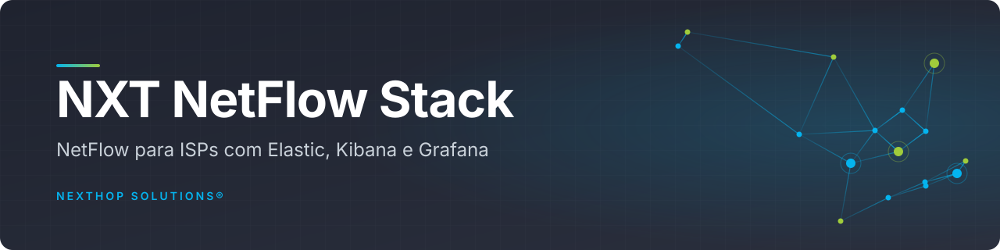
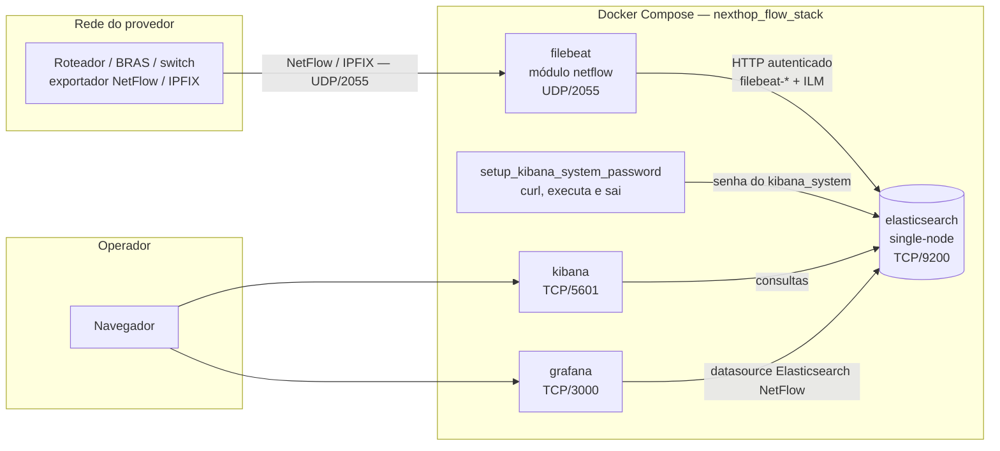

<!--
SPDX-License-Identifier: Apache-2.0
Autor/desenvolvedor: Elizandro Pacheco — NextHop Solutions® (https://nexthop.solutions/).
Licença e atribuições: consulte LICENSE e NOTICE na raiz do repositório.
Modificado em 2026-10-01: atualização da stack, testes, documentação e avisos.
Modificado em 2026-10-28: README reorganizado no padrão de documentação dos repositórios.
-->

<div align="center">



<br>

**Visibilidade de tráfego NetFlow/IPFIX para provedores de Internet, com Elasticsearch, Kibana, Filebeat e Grafana em um único Docker Compose.**

[](LICENSE)
[](https://github.com/nexthopsolutions/nxt-netflow-stack)
[](https://github.com/nexthopsolutions/nxt-netflow-stack/commits)
[](https://github.com/nexthopsolutions/nxt-netflow-stack/stargazers)


[Começando](#começando) · [Arquitetura](#arquitetura) · [Portas e endpoints](#portas-e-endpoints) · [Dashboard](template-grafana.json) · [Solução de problemas](#solução-de-problemas)

</div>

---

> [!TIP]
> **O projeto ajudou você? Dê uma estrela** no [repositório](https://github.com/nexthopsolutions/nxt-netflow-stack),
> pelo botão **Star** no topo da página. Isso ajuda outros profissionais a encontrar a solução e apoia
> sua divulgação na comunidade.

> [!IMPORTANT]
> Esta configuração é uma base **single-node para laboratório e testes locais**. Para produção,
> dimensione recursos, retenção, autenticação, TLS e backups conforme o seu ambiente.

## Sumário

- [Sobre](#sobre)
- [Destaques](#destaques)
- [Arquitetura](#arquitetura)
- [Stack](#stack)
- [Começando](#começando)
- [Portas e endpoints](#portas-e-endpoints)
- [Configuração e credenciais](#configuração-e-credenciais)
- [Uso](#uso)
- [Persistência, retenção e atualização](#persistência-retenção-e-atualização)
- [Testes e operação](#testes-e-operação)
- [Segurança em produção](#segurança-em-produção)
- [Solução de problemas](#solução-de-problemas)
- [Estrutura do projeto](#estrutura-do-projeto)
- [Materiais](#materiais)
- [Apoiadores](#apoiadores)
- [Contribuição](#contribuição)
- [Segurança](#segurança)
- [Licença](#licença)
- [Autor](#autor)

## Sobre

Provedores de Internet precisam saber para onde vai o tráfego: quais IPs, portas, ASNs e regiões
concentram o volume. O **nxt-netflow-stack** (NextHop Flow Stack) entrega isso pronto: os equipamentos
exportam NetFlow/IPFIX para o Filebeat, os eventos são indexados no Elasticsearch, o Kibana permite
explorá-los e o Grafana exibe um dashboard provisionado automaticamente.

A stack foi desenvolvida pela **NextHop Solutions®**, através de seu CEO **Elizandro Pacheco**, como
contribuição para a comunidade. Foi preparada para apresentação na
[15ª Semana de Infraestrutura da Internet no Brasil](https://semanainfra.nic.br/) e no
[GTER/GTS](https://gtergts.nic.br/).

## Destaques

- **Um comando para subir** — cinco serviços no `docker-compose.yaml`, com versões fixadas por tag.
- **NetFlow v5/v9 e IPFIX** — módulo NetFlow do Filebeat escutando em UDP/2055.
- **Dashboard pronto** — datasource e dashboard Grafana provisionados, com taxa em bps
  (Kbps/Mbps/Gbps), top 20 de IPs, portas, ASNs e AS, e tráfego por país, estado e cidade via GeoIP.
- **Retenção automática** — política ILM `filebeat` versionada: rollover diário ou por 5 GB e exclusão
  7 dias após o rollover.
- **Segredos fora do Git** — o Compose recusa senhas vazias; o Quick start gera um `.env` com tokens
  exclusivos e permissão `0600`.
- **Teste de ponta a ponta** — `scripts/smoke-test.py` envia um fluxo NetFlow v5 e confere a ingestão no
  Elasticsearch e a consulta no Grafana.
- **Exemplos de exportadores** — MikroTik/RouterOS e Huawei VRP/NetStream.

## Arquitetura



O módulo NetFlow do Filebeat decodifica os fluxos e envia os eventos ao Elasticsearch. O Grafana consulta
`filebeat-*`; o Kibana permite explorar o mesmo conjunto de dados.

Ordem de inicialização: o `elasticsearch` sobe e passa no healthcheck; o `setup_kibana_system_password`
configura a senha interna e encerra com código 0; só então o `kibana` inicia. O `filebeat` instala a
política ILM (`filebeat setup --index-management`) antes de coletar.

<a id="componentes"></a>

## Stack

Versões fixadas no `docker-compose.yaml` e verificadas em **01/10/2026**:

| Camada | Tecnologia | Versão | Função |
|---|---|---|---|
| Armazenamento | Elasticsearch | 9.5.4 | Armazenamento e busca |
| Exploração | Kibana | 9.5.4 | Exploração dos eventos |
| Coleta | Filebeat | 9.5.4 | Coleta e decodificação de NetFlow/IPFIX |
| Visualização | Grafana | 13.2.3 | Dashboard de tráfego |
| Bootstrap | curl (`curlimages/curl`) | 8.22.0 | Inicialização da senha de `kibana_system` |
| Orquestração | Docker Compose | v2 | Serviços, rede, volumes |
| Testes | Python 3 (biblioteca padrão) | 3 | `.env` e smoke test |

Fontes oficiais: [Elasticsearch](https://www.elastic.co/downloads/elasticsearch/),
[Kibana](https://www.elastic.co/downloads/kibana), [Filebeat](https://www.elastic.co/downloads/beats/filebeat),
[Grafana](https://grafana.com/grafana/download) e [curl](https://hub.docker.com/r/curlimages/curl/tags).

As tags são explícitas: `docker compose pull` baixa as versões declaradas, sem trocar automaticamente para
uma versão futura. Mantenha os três componentes Elastic na mesma versão ao atualizar.

<a id="quick-start"></a>

## Começando

<a id="pre-requisitos"></a>

### Pré-requisitos

- Docker Engine com Docker Compose v2 ou superior, ou Docker Desktop com Compose.
- Python 3 para gerar o `.env` e executar o teste, sem bibliotecas adicionais.
- [Portas](#portas-e-endpoints) disponíveis e acesso aos registries para baixar as imagens.
- Ponto de partida para laboratório: 2 vCPU e pelo menos 4 GB de RAM para a stack. Considere 8 GB ou mais
  no Docker Desktop quando houver outros projetos rodando. Isso não é dimensionamento de produção.
- Disco conforme o volume de fluxos e a [retenção](#retenção-e-backup).

A execução local desta versão foi validada em Docker Desktop **ARM64**. Valide desempenho e capacidade no
hardware de destino.

#### Memória virtual no Linux

A documentação atual da Elastic recomenda `vm.max_map_count=1048576` para versões recentes. Consulte
[configuração do sistema](https://www.elastic.co/docs/deploy-manage/deploy/self-managed/important-system-configuration).

```bash
sudo sysctl -w vm.max_map_count=1048576
```

Para persistir, adicione `vm.max_map_count=1048576` em um arquivo de sysctl, como
`/etc/sysctl.d/99-elasticsearch.conf`, e aplique com `sudo sysctl --system`.

No Docker Desktop, o kernel relevante é o da VM Linux do Docker, não o do macOS. Consulte as instruções da
Elastic para a sua plataforma antes de aplicar ajustes.

### 1. Obtenha o projeto

```bash
git clone https://github.com/nexthopsolutions/nxt-netflow-stack.git
cd nxt-netflow-stack
```

### 2. Gere o `.env` com senhas exclusivas

O comando abaixo copia `env.example` e preenche as três senhas. Ele **recusa sobrescrever um `.env`
existente**.

```bash
python3 - <<'PY'
from pathlib import Path
import os
import secrets

text = Path('env.example').read_text()
for key in ('ELASTIC_PASSWORD', 'KIBANA_SYSTEM_PASSWORD', 'GRAFANA_ADMIN_PASSWORD'):
    text = text.replace(key + '=\n', key + '=' + secrets.token_urlsafe(32) + '\n')
fd = os.open('.env', os.O_WRONLY | os.O_CREAT | os.O_EXCL, 0o600)
with os.fdopen(fd, 'w') as output:
    output.write(text)
print('.env criado com senhas exclusivas.')
PY
```

Se preferir configurar manualmente, copie `env.example` para `.env` e preencha os campos de senha vazios
antes de subir. Não reutilize senhas publicadas em versões antigas do exemplo.

### 3. Valide e inicie

```bash
docker compose config -q
docker compose pull
docker compose up -d
docker compose ps -a
```

A primeira inicialização pode levar alguns minutos. `setup_kibana_system_password` deve terminar com
**Exited (0)**; os outros quatro serviços devem permanecer em execução. `up -d` sozinho não comprova que
todas as aplicações estão prontas.

### 4. Acesse e teste

- **[Grafana](http://localhost:3000)** — usuário `admin` (ou `GRAFANA_ADMIN_USER`) e senha
  `GRAFANA_ADMIN_PASSWORD` do `.env`.
- **[Kibana](http://localhost:5601)** — usuário `elastic` e senha `ELASTIC_PASSWORD` do `.env`.

```bash
python3 scripts/smoke-test.py
```

O teste gera um evento sintético. Para receber tráfego real, configure os equipamentos para exportar para
o **IP do host Docker, UDP/2055** (veja [exportadores](#exportadores-netflow)).

## Portas e endpoints

| Serviço | Porta no host | Publicação padrão | Endereço de acesso / destino |
|---|---|---|---|
| Elasticsearch | TCP/9200 | `127.0.0.1` | [http://127.0.0.1:9200](http://127.0.0.1:9200) |
| Kibana | TCP/5601 | `127.0.0.1` | [http://127.0.0.1:5601](http://127.0.0.1:5601) |
| Grafana | TCP/3000 | `127.0.0.1` | [http://127.0.0.1:3000](http://127.0.0.1:3000) |
| Filebeat NetFlow | UDP/2055 | Todas as interfaces disponíveis | `<IP_DO_HOST_DOCKER>:2055` via UDP; sem interface HTTP |

Os links `127.0.0.1` devem ser abertos na própria máquina que executa o Docker. Para exportar flows de um
equipamento de rede, use o IP alcançável do host Docker, não `127.0.0.1`.

Para acessar as interfaces HTTP a partir de outra máquina, configure `HTTP_BIND_ADDRESS` com o IP da
interface do host desejada e execute `docker compose up -d`. `0.0.0.0` publica em todas as interfaces
IPv4; restrinja o acesso por firewall/VPN. Esse ajuste **não altera** a publicação UDP.

O teste automatizado usa `127.0.0.1` e as portas padrão. Execute-o com a publicação HTTP padrão ou em
`0.0.0.0`. Se publicar exclusivamente em um IP de LAN, o teste precisará ser adaptado.

<a id="configuracao-env"></a>

## Configuração e credenciais

| Variável | Uso / padrão |
|---|---|
| `TZ` | Fuso dos containers; `America/Sao_Paulo` |
| `HTTP_BIND_ADDRESS` | IP de publicação HTTP; `127.0.0.1` |
| `ES_JAVA_OPTS` | Heap da JVM; `-Xms512m -Xmx512m` |
| `ELASTIC_PASSWORD` | Senha inicial do usuário `elastic`; obrigatória |
| `KIBANA_SYSTEM_PASSWORD` | Senha do usuário interno `kibana_system`; obrigatória |
| `GRAFANA_ADMIN_USER` | Administrador inicial do Grafana; `admin` |
| `GRAFANA_ADMIN_PASSWORD` | Senha inicial do administrador; obrigatória |

O Compose recusa senhas ausentes ou vazias. O bootstrap aceita `KIBANA_SYSTEM_PASSWORD` somente com
letras, números, `_` e `-`; use tokens URL-safe como os do Quick start.

O Elasticsearch tem limite de **1 GB** no Compose e heap padrão de **512 MB**. Se ampliar o heap, ajuste
também o limite do container e reserve memória para os demais serviços.

### Inicialização e troca de senha

O serviço `setup_kibana_system_password` aguarda o healthcheck do Elasticsearch, configura a senha interna
e encerra. O Kibana só inicia após o sucesso dessa etapa. `kibana_system` não é o usuário para login no
navegador.

As variáveis de administrador do Elasticsearch e do Grafana inicializam **volumes vazios**. Alterar apenas
o `.env` não troca a senha de usuários já persistidos. Para manter os dados, altere as credenciais pelas
ferramentas/API de cada produto e atualize os consumidores. Recriar volumes é uma opção apenas quando a
perda de todos os dados for intencional.

<a id="interfaces"></a>

## Uso

### Grafana

O datasource **Elasticsearch NetFlow** e o dashboard da pasta **NetFlow** são provisionados
automaticamente. O UID do datasource coincide com o referenciado pelo JSON do dashboard.

Abra o [dashboard NetFlow](http://localhost:3000/d/fff4a0e1-5179-4224-b3bc-8377fc6fcdb3). Os painéis
exibem **bps**, com escala decimal automática para **Kbps, Mbps e Gbps**. Cada janela fixa de 10 segundos
calcula `soma(network.bytes) × 8 / 10`. Os gráficos geográficos mostram a média das janelas completas do
período. Portas de origem/destino não representam, por si só, direção de entrada/saída. A atualização
automática ocorre a cada **30 segundos**.

A taxa é baseada no timestamp dos eventos reportados: fluxos longos exportados em lote podem gerar picos.
Ela não equivale à medição instantânea da interface nem redistribui os bytes pela duração original dos
fluxos. Ajuste os timeouts de exportação conforme a resolução desejada.

A janela inicial é de **15 minutos**; ajuste o intervalo para encontrar eventos mais antigos. Sem fluxos
recebidos, os painéis podem ficar sem dados.

O dashboard é mantido em `template-grafana.json`. Para preservar uma personalização, exporte o JSON e
atualize esse arquivo, ou crie uma cópia com outro UID. O provisionamento não grava alterações da interface
de volta no arquivo e pode substituir versões salvas na base. Veja
[provisionamento do Grafana](https://grafana.com/docs/grafana/latest/administration/provisioning/).

### Kibana

Depois de receber o primeiro evento, abra **Discover** e crie uma data view com:

- Nome: `NetFlow`.
- Padrão de índice: `filebeat-*`.
- Campo de tempo: `@timestamp`.

A data view não é criada automaticamente por este Compose. Para localizar o teste, filtre
`source.ip: "192.0.2.10"` e ajuste o intervalo de tempo.

<a id="exportadores-netflow"></a>

### Exportadores NetFlow

Configure o destino como **IP do host Docker** e a porta **UDP/2055**. O Filebeat suporta NetFlow v5/v9 e
IPFIX, entre outros formatos descritos no
[módulo oficial](https://www.elastic.co/guide/en/beats/filebeat/current/filebeat-module-netflow.html).

Para v9/IPFIX, o coletor precisa receber os templates do exportador antes de decodificar os registros. Após
reiniciar o Filebeat, aguarde o reenvio dos templates. ACLs, NAT, firewall e redes do Docker Desktop devem
permitir o tráfego até o coletor.

<details>
<summary><b>MikroTik / RouterOS</b></summary>

Exemplo para NetFlow v9; ajuste interfaces e timeouts ao ambiente:

```text
/ip traffic-flow set enabled=yes interfaces=all cache-entries=4k active-flow-timeout=30m inactive-flow-timeout=15s
/ip traffic-flow target add dst-address=<IP_DO_SERVIDOR_FILEBEAT> port=2055 version=9
```

Confira os destinos existentes com `/ip traffic-flow target print` antes de adicionar outro. O timeout
ativo de 30 minutos do exemplo pode atrasar a visibilidade de fluxos longos; ajuste-o se precisar de maior
frequência de exportação.

Referência: [MikroTik — Traffic Flow](https://help.mikrotik.com/docs/spaces/ROS/pages/21102653/Traffic%2BFlow).

</details>

<details>
<summary><b>Huawei VRP / NetStream</b></summary>

Exemplo de configuração NetStream para exportar **NetFlow v9** ao Filebeat em **UDP/2055**. Substitua os
valores entre `<...>` antes de aplicar:

```text
system-view
ip netstream export version 9
ip netstream export host <IP_DO_SERVIDOR_FILEBEAT> 2055
ip netstream export source <IP_DE_ORIGEM_DO_EXPORTADOR>
ip netstream timeout active 1
ip netstream timeout inactive 15

interface <INTERFACE_MONITORADA>
 ip netstream inbound
 ip netstream outbound
quit
return
save
```

- `<IP_DO_SERVIDOR_FILEBEAT>` — endereço do host que executa esta stack, alcançável pelo equipamento.
- `<IP_DE_ORIGEM_DO_EXPORTADOR>` — IP local do equipamento usado como origem dos pacotes de exportação,
  por exemplo o endereço de uma loopback com rota até o coletor.
- `<INTERFACE_MONITORADA>` — interface cujo tráfego será coletado; repita o bloco para outras interfaces.

A sintaxe, as unidades dos timeouts e a necessidade de `commit` variam conforme o modelo e a versão do VRP.
Algumas plataformas usam a família de comandos `netstream export ip` em vez de `ip netstream export`.
Confirme no manual do equipamento; ajuste interfaces, direção e timeouts ao seu ambiente. O comando `save`
persiste a configuração após a validação.

Referência: [Huawei — exemplo de exportação de estatísticas de fluxo](https://support.huawei.cn/enterprise/en/doc/EDOC1100468733/85a6c438/example-for-configuring-flexible-flow-statistics-export).

</details>

<a id="persistencia-e-dados"></a>

## Persistência, retenção e atualização

Com o nome padrão do projeto Compose (`nexthop_flow_stack`), os volumes são:

| Volume | Conteúdo |
|---|---|
| `nexthop_flow_stack_elasticsearch_v9_data` | Eventos, índices e estado do Elasticsearch |
| `nexthop_flow_stack_grafana_v13_data` | Banco e estado persistente do Grafana |

```bash
docker volume ls --filter name=nexthop_flow_stack
```

O Filebeat não possui volume persistente nesta configuração; seu estado local e templates em memória não
sobrevivem à recriação. UDP não garante entrega, e fluxos recebidos durante interrupções podem ser perdidos.

### Retenção e backup

A stack instala automaticamente a política ILM `filebeat`, definida em
[`elasticsearch/ilm-policy.json`](elasticsearch/ilm-policy.json):

| Parâmetro | Padrão | Efeito |
|---|---|---|
| `hot.actions.rollover.max_age` | `1d` | Rollover por idade do índice |
| `hot.actions.rollover.max_primary_shard_size` | `5gb` | Rollover quando o maior shard primário atingir esse tamanho |
| `delete.min_age` | `7d` | Exclusão do índice 7 dias após o rollover |

O rollover ocorre quando qualquer limite máximo é atingido, normalmente para índices não vazios. O índice
de escrita permanece ativo até o rollover. A idade da fase de exclusão é contada **a partir do rollover**,
não do timestamp de cada evento: com rollover diário, dados ingeridos podem permanecer aproximadamente
**7 a 8 dias**, além do tempo de execução do ILM. Eventos antigos recebidos com atraso não são eliminados
pelo seu timestamp original. Consulte a
[documentação de rollover e idade das fases](https://www.elastic.co/docs/manage-data/lifecycle/index-lifecycle-management/rollover).

> [!WARNING]
> **A retenção exclui dados automaticamente e de forma definitiva.** Este padrão é destinado à stack
> dedicada. Ao atualizar uma instalação existente, a política `filebeat` será substituída e índices já
> vinculados a ela poderão tornar-se elegíveis para exclusão. Confira o histórico necessário e faça backup
> antes de aplicar. Não use essa política compartilhada com outros produtores sem revisar o impacto.

Para ajustar, edite os três valores no JSON e recrie o Filebeat:

```bash
docker compose up -d --force-recreate filebeat
```

O arquivo versionado é a fonte de verdade: `setup.ilm.overwrite: true` reaplica a política na inicialização
do Filebeat. Alterações feitas apenas pelo Kibana serão sobrescritas. Índices com outra política ou sem ILM
precisam de avaliação/migração específica; esta configuração não os adota automaticamente. Mudanças em
políticas de índices existentes podem aguardar a transição de fase, por causa do cache de execução do ILM.

**Retenção por tempo não é limite de disco.** O rollover de 5 GB limita o tamanho-alvo de cada shard, não a
soma dos índices. Como estimativa inicial, use `GB indexados por dia × 8 dias × (1 + número de réplicas)`,
acrescente margem para translogs, merges, logs e outros serviços e mantenha espaço livre. Meça os bytes
armazenados no Elasticsearch: tráfego em Gbps não se converte diretamente em GB de documentos NetFlow. Os
watermarks do Elasticsearch protegem a alocação/escrita, mas não substituem exclusão nem alertas de disco.

Os logs Docker usam rotação de **10 MB × 3 arquivos por container** (`json-file`). Isso limita os logs dos
containers desta stack, não os índices, imagens, cache de build ou volumes de outros projetos.

Verifique pelo **Kibana → Dev Tools** (usuário com permissões apropriadas):

```http
GET _ilm/policy/filebeat
GET filebeat-*/_ilm/explain
GET _cat/indices/filebeat-*?v&bytes=gb&expand_wildcards=all
GET _cat/allocation?v&bytes=gb
```

Confirme `managed: true`, política `filebeat` e ausência de erros no `_ilm/explain`. Uma política criada,
mas não vinculada aos índices, não garante retenção. O smoke test verifica o conteúdo da política e o
vínculo dos índices existentes, sem esperar sete dias nem apagar dados para testar.

Para dados importantes, configure snapshots do Elasticsearch e backup consistente do Grafana, além de
guardar configurações e segredos com acesso restrito. Volumes Docker não substituem backups. Defina também
retenção dos próprios snapshots.

### Atualização da stack antiga

Os volumes atuais têm nomes diferentes dos usados com Elastic 8.12.2/Grafana 11.2.0. Atualizar o checkout
não migra nem apaga os volumes antigos automaticamente.

> [!CAUTION]
> **Não monte um volume 8.12.2 diretamente no Elasticsearch 9.5.4.** Para preservar dados, siga o
> [caminho de atualização da Elastic](https://www.elastic.co/docs/deploy-manage/upgrade/deployment-or-cluster),
> incluindo versões intermediárias e verificação de compatibilidade. Faça backup antes da migração. Para
> testes do zero, use volumes novos.

Para uma atualização futura, revise as notas de versão, altere as tags no Compose, planeje a compatibilidade
dos volumes e execute os testes após a inicialização. Voltar somente a tag da imagem não é um rollback
seguro de dados já migrados.

<a id="operacao"></a>

## Testes e operação

### Teste local de ponta a ponta

```bash
python3 scripts/smoke-test.py
```

O script verifica HTTP/saúde das aplicações, versões do Elasticsearch e Grafana, dashboard provisionado e
datasource. Envia um fluxo NetFlow v5 por UDP e confirma **10 pacotes e 1.200 bytes** no Elasticsearch,
seguido de consulta pela API de queries do Grafana. Sai com erro quando uma verificação falha.

O evento usa `192.0.2.10` e `198.51.100.20`, endereços reservados para documentação, e permanece no índice.
O teste também consulta os nove painéis, verifica unidades em bps e confere a taxa de 960 bps para um
evento de 1.200 bytes em uma janela de 10 segundos nos quatro painéis de IPs/portas. Simula o pipeline de
GeoIP com IPs públicos, sem indexar esses eventos, para verificar país e organizações AS; aguarde o
download inicial das bases antes de executar. Cidade/estado dependem da cobertura das bases e podem estar
ausentes mesmo para IPs públicos.

> [!NOTE]
> O teste não valida exportadores físicos, v9/IPFIX, carga sustentada, perda de pacotes ou a aparência de
> todos os painéis.

Verificações adicionais do Filebeat:

```bash
docker compose exec -T filebeat filebeat version
docker compose exec -T filebeat filebeat test config --strict.perms=false
docker compose exec -T filebeat filebeat test output --strict.perms=false
```

### Iniciar ou aplicar mudanças no Compose / `.env`

```bash
docker compose config -q
docker compose up -d
```

`docker compose restart` não aplica mudanças nas variáveis de ambiente do container; use `up -d` para
recriá-lo quando necessário.

### Status e logs

```bash
docker compose ps -a
docker compose logs --tail=100
docker compose logs -f filebeat
```

### Parar e retomar

```bash
docker compose stop
docker compose start
```

### Remover containers e rede, preservando volumes

```bash
docker compose down
```

### Apagar os dados desta configuração

> [!WARNING]
> **Este comando apaga os dados.** Ele remove os volumes atuais, incluindo eventos e estado do Grafana. Use
> somente para reinicialização intencional ou após backup.

```bash
docker compose down -v
docker compose up -d
```

Volumes antigos com nomes diferentes não são removidos por esse comando. Identifique-os antes de qualquer
remoção manual. O `.env` e os arquivos montados do repositório permanecem no host.

<a id="seguranca-producao"></a>

## Segurança em produção

- Mantenha as interfaces HTTP atrás de VPN ou proxy com TLS e autenticação; não exponha diretamente
  9200/5601/3000 na Internet.
- Esta configuração usa HTTP também entre containers. Planeje TLS interno para produção.
- Filebeat e o datasource usam o superusuário `elastic` por simplicidade de laboratório. Em produção,
  separe identidades e permissões de ingestão, consulta e administração.
- Restrinja a origem dos pacotes UDP/2055 aos exportadores autorizados.
- Mantenha `.env` fora do Git, use senhas exclusivas e proteja backups/segredos.
- Configure chaves persistentes de criptografia do Kibana para sessões, saved objects e reporting. O
  Compose atual não define essas chaves; alguns recursos de alertas/actions ficam indisponíveis e sessões
  podem ser invalidadas em reinícios.
- O downloader GeoIP do Elasticsearch está ativado e baixa as bases City/Country/ASN. Requer acesso à
  Internet aos endpoints da Elastic e de armazenamento das bases. IPs privados/reservados podem não ter
  localização ou organização AS; eventos antigos não são enriquecidos retroativamente.

<a id="troubleshooting"></a>

## Solução de problemas

<details>
<summary><b>Compose acusa senha ausente</b></summary>

Preencha as três senhas do `.env` ou gere o arquivo pelo [Quick start](#2-gere-o-env-com-senhas-exclusivas).
`env.example` propositalmente não fornece credenciais prontas.

</details>

<details>
<summary><b>Porta já está em uso</b></summary>

Identifique o processo/container que ocupa a porta. Ajustar as portas publicadas exige atualizar também URLs
e o teste local; não encerre serviços de outros projetos sem verificar sua finalidade.

</details>

<details>
<summary><b>Elasticsearch reinicia ou não inicia</b></summary>

Confira `docker compose logs --tail=100 elasticsearch`, memória disponível, espaço em disco,
`vm.max_map_count` e compatibilidade do volume com a versão. Aumentar só o heap sem ajustar o limite de
1 GB pode causar falta de memória.

</details>

<details>
<summary><b>Elasticsearch retorna 401 ou aparece healthy sem aceitar login</b></summary>

O healthcheck do Compose aceita 200/401 para detectar que o endpoint está respondendo. Isso não comprova
credenciais válidas nem saúde do cluster. O smoke test faz a verificação autenticada e aceita cluster
`green` ou `yellow`; em single-node, réplicas não alocadas podem causar `yellow`.

</details>

<details>
<summary><b>Kibana não conecta</b></summary>

```bash
docker compose logs --tail=100 setup_kibana_system_password kibana
```

O setup deve encerrar com código 0. Confirme credenciais, formato URL-safe de `KIBANA_SYSTEM_PASSWORD` e
se houve alteração de senha no `.env` sem atualização do usuário persistido.

</details>

<details>
<summary><b>Grafana sem dados ou datasource com erro</b></summary>

Confira autenticação do datasource, existência de eventos em `filebeat-*` e intervalo de tempo. Antes do
primeiro evento, o índice pode ainda não existir. Execute o smoke test e consulte os logs do Filebeat. Para
personalizações do dashboard, mantenha o UID do datasource coerente com o JSON.

</details>

<details>
<summary><b>Fluxos do equipamento não aparecem</b></summary>

Verifique destino/porta, interface de origem, ACLs e chegada dos pacotes UDP ao host. Em v9/IPFIX, aguarde
os templates. Confira os timeouts de exportação, horário do equipamento e logs do Filebeat. O sucesso do
teste local comprova ingestão local, mas não a conectividade entre roteador e host.

</details>

<details>
<summary><b><code>filebeat test output</code> avisa que TLS está desativado</b></summary>

É esperado no laboratório: a saída está configurada como `http://elasticsearch:9200`. Para produção,
configure TLS e a confiança nos certificados.

</details>

## Estrutura do projeto

| Arquivo | Responsabilidade |
|---|---|
| `docker-compose.yaml` | Serviços, versões, portas, rede, volumes e rotação de logs |
| `env.example` | Modelo de configuração sem senhas preenchidas |
| `.env` | Credenciais locais; ignorado pelo Git |
| `filebeat.yml` | Módulo NetFlow, saída e instalação da política ILM |
| `elasticsearch/ilm-policy.json` | Rollover e exclusão automática dos índices NetFlow |
| `grafana/provisioning/datasources/elasticsearch.yaml` | Datasource Elasticsearch |
| `grafana/provisioning/dashboards/netflow.yaml` | Provisionamento do dashboard |
| `template-grafana.json` | Dashboard carregado na pasta NetFlow |
| `scripts/smoke-test.py` | Teste local de ingestão e consulta |
| `LICENSE` / `LICENSE.pt-BR.md` / `NOTICE` | Licença Apache-2.0, tradução de referência e avisos de atribuição |

## Materiais

- [Template do dashboard Grafana](template-grafana.json)
- [Apresentação na GTER](./%5BGTER%2054%5D%20Elizandro%20Pacheco.pdf)

## Apoiadores

Obrigado aos apoiadores que fortalecem a iniciativa e a comunidade.

<table>
  <tr>
    <td align="center" width="50%">
      <a href="https://nexthop.solutions/">
        
      </a><br>
      <sub><b>NextHop Solutions®</b> · <a href="https://nexthop.solutions/">nexthop.solutions</a></sub>
    </td>
    <td align="center" width="50%">
      <a href="https://evocode.ia.br/">
        
      </a><br>
      <sub><b>EvoCODE IA®</b> · <a href="https://evocode.ia.br/">evocode.ia.br</a></sub>
    </td>
  </tr>
</table>

## Contribuição

O projeto é aberto à comunidade, e contribuições são bem-vindas: correções, novos exemplos de exportadores
(outros fabricantes e versões), melhorias no dashboard, na documentação e no smoke test.

- **Issues** — relate bugs, dúvidas de configuração ou sugestões em
  [Issues](https://github.com/nexthopsolutions/nxt-netflow-stack/issues). Inclua versões, saída de
  `docker compose ps -a` e logs relevantes, **sem senhas nem IPs sensíveis**.
- **Pull requests** — faça um fork, crie um branch a partir de `main` (ex.: `feat/exportador-juniper`),
  use [Conventional Commits](https://www.conventionalcommits.org/) (`feat:`, `fix:`, `docs:`…) e abra o PR
  descrevendo o problema, a mudança e como testou.
- Antes de abrir o PR, rode `docker compose config -q` e `python3 scripts/smoke-test.py`.
- Arquivos modificados devem manter o cabeçalho SPDX e indicar a modificação, conforme a seção 4(b) da
  Apache-2.0.

## Segurança

Não abra issue pública para vulnerabilidades. Reporte de forma privada pelo
[GitHub Security Advisories](https://github.com/nexthopsolutions/nxt-netflow-stack/security/advisories/new)
do repositório ou fale diretamente com o autor pelo [GitHub](https://github.com/elizandropacheco).

<a id="licenca"></a>

## Licença

Este projeto é distribuído sob a licença **Apache 2.0**. Consulte [LICENSE](LICENSE) e os créditos de
[NOTICE](NOTICE). Autor/desenvolvedor: **Elizandro Pacheco — NextHop Solutions®**.

NextHop Solutions®, EvoCODE IA® e Network Education® são marcas registradas. A licença não concede
autorização geral de uso dessas marcas; preserva o uso razoável necessário para identificar a origem da obra
e reproduzir os avisos, conforme a seção 6.

As imagens e dependências utilizadas possuem suas próprias licenças; a licença do repositório não substitui
as condições de cada componente.

A tradução de referência está em [LICENSE.pt-BR.md](LICENSE.pt-BR.md). Em caso de dúvida legal, vale o
texto em inglês de [LICENSE](LICENSE).

<details>
<summary><b>Resumo simples: o que pode e o que não pode</b></summary>

> Este resumo é prático e **não** substitui a leitura do `LICENSE`, nem é aconselhamento jurídico.

**Você pode**

- **Usar** a stack/código para qualquer finalidade, inclusive **comercial**.
- **Modificar** (criar derivações/forks), inclusive rebatizar o seu fork e manter outro mantenedor.
- **Redistribuir** o original ou versões modificadas, em código-fonte ou empacotado.

**Você deve**

- **Incluir uma cópia da licença Apache 2.0** quando redistribuir.
- **Manter avisos de copyright/atribuição** e notices existentes.
- **Indicar mudanças**: arquivos modificados devem conter aviso claro de que foram alterados.
- **Preservar os avisos de atribuição aplicáveis de [NOTICE](NOTICE)** nas redistribuições, conforme a
  seção 4(d) da licença.

**Você não pode**

- **Usar marcas, nome ou logotipos** da NextHop Solutions® (ou de terceiros) como se houvesse endosso ou
  afiliação: a Apache 2.0 **não concede licença de marca** (ver "Trademarks" no `LICENSE`).
- **Remover avisos legais e de atribuição** aplicáveis às partes redistribuídas, em desacordo com a seção 4
  da licença.

Em outras palavras: a Apache 2.0 permite usar, alterar e redistribuir, e até trocar o mantenedor do _seu
fork_, **desde que** você cumpra as obrigações de atribuição/licença e não use marcas como se fossem
permissão ou endosso.

</details>

## Autor

<table>
  <tr>
    <td align="center">
      <a href="https://github.com/elizandropacheco">
        <br>
        <sub><b>Elizandro Pacheco</b></sub>
      </a><br>
      <sub>Desenvolvedor e autor do projeto</sub>
    </td>
  </tr>
</table>

[](https://elizandropacheco.io)
[](https://www.linkedin.com/in/elizandropacheco)
[](https://github.com/elizandropacheco)
[](https://www.youtube.com/@ElizandroPacheco)
[](https://www.instagram.com/elizandropacheco)

<div align="center">
<sub>Feito por <a href="https://github.com/elizandropacheco">Elizandro Pacheco</a> · <a href="https://nexthop.solutions">NextHop Solutions®</a></sub>
</div>
